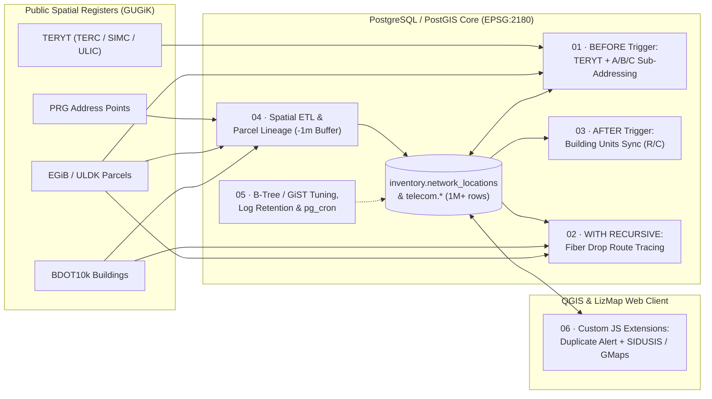

# Spatial Data Engineering & Telecom GIS Portfolio

-informational)

Modular **Spatial SQL, PL/pgSQL, PostGIS, and WebGIS (LizMap JavaScript)** engineering solutions designed for large-scale **FTTH (Fiber-to-the-Home) telecommunications network inventory** environments (**1M+ spatial records**, **100+ schemas**, **100+ concurrent internal users**).

---

## System Architecture Overview

All six modules operate across a unified spatial database and WebGIS architecture:

---

## Repository Modules

| # | Module | Primary Focus | Key SQL / PostGIS / JS Techniques |
| :-: | :--- | :--- | :--- |
| **01** | **[Address Validation & TERYT Trigger](./01-address-validation-trigger/)** | Real-time data integrity & spatial geocoding | `BEFORE INSERT OR UPDATE OF ...`, `ST_Intersects`, `TERC/SIMC/ULIC` dictionary resolution, sequential `A/B/C` parcel sub-addressing, `SQLSTATE 23505` |
| **02** | **[Recursive Fiber Drop-Cable Tracing](./02-recursive-fiber-route-tracing/)** | Graph topology & right-of-way analytics | `WITH RECURSIVE`, cycle-prevention arrays (`ANY(...)`), node-degree stop criteria, `ST_Difference` + `ST_DWithin`, `LEFT JOIN LATERAL` |
| **03** | **[Building Units Sync Engine](./03-building-units-sync-engine/)** | Event-driven premise provisioning | `generate_series`, `regexp_replace`, lock/manual deletion guards, `GET DIAGNOSTICS`, FK B-tree indexing, transactional `ROLLBACK` tests |
| **04** | **[Cadastral ETL & Parcel Lineage](./04-cadastral-etl-and-parcel-lineage/)** | National register sync & subdivision history | Dual spatial anti-joins (`ST_Contains`, `ST_DWithin`), inward negative buffer `ST_Buffer(geom, -1.0)` lineage mapping, `GiST` indexing |
| **05** | **[DB Performance, Log Retention & `pg_cron`](./05-db-performance-and-maintenance/)** | DBA maintenance & query optimization | B-tree indexing on **4M+ row** audit logs, SQL-injection-safe dynamic SQL (`format('%I')`), PG 9→16 compatibility, `pg_cron` day/night schedules |
| **06** | **[LizMap WebGIS JS Extensions](./06-lizmap-webgis-extensions/)** | Frontend WebGIS UX & coordinate reprojection | `MutationObserver` WFS-T error modal, `OpenLayers.Projection` (`EPSG:2180` → `EPSG:4326`), one-click **SIDUSIS (`internet.gov.pl`)** & Google Maps tools |

---

## Engineering Highlights by Module

### 01 · Real-Time Spatial Address Validation & Sub-Addressing (`PL/pgSQL`)
Centralizes validation inside PostgreSQL so rules apply identically across desktop **QGIS**, **LizMap WFS-T** forms, and batch imports:
- Automatically populates `TERC` from cadastral district polygons (`ST_Intersects` in `EPSG:2180`), resolves `SIMC`/`ULIC` dictionary codes, and applies `'99999'` for streetless villages.
- Dynamically manages unnumbered parcel installations (`house_number IS NULL`): when a second endpoint lands on the same plot, it retroactively labels the first record `'A'` and assigns `'B'`, `'C'`, … sequentially.
- Blocks active address duplicates (`merged_into_id IS NULL`) using NULL-safe `IS NOT DISTINCT FROM` predicates.
- 📄 **Code:** [`01-address-validation-trigger/address_validation_trigger.sql`](./01-address-validation-trigger/address_validation_trigger.sql)

### 02 · Recursive Fiber-Optic Drop-Cable Route Tracing (`WITH RECURSIVE` + `PostGIS`)
Reconstructs physical subscriber drop paths backwards from customer **ONT sockets** across pass-through joints (`degree <= 2`) up to **backbone splice closures** (`degree > 2`):
- Prevents infinite traversal on cyclic cable rings using visited-node and visited-cable PostgreSQL arrays.
- Clips schematic indoor cable tails cleanly to exterior **BDOT10k** building walls (`ST_Difference` accelerated by `ST_DWithin(..., 100)`).
- Consolidates `MultiLineString` geometries per infrastructure owner and classifies routing (`Subscriber Parcel` vs. `Road Right-of-Way` vs. `Mixed`) via `LEFT JOIN LATERAL`.
- 📄 **Code:** [`02-recursive-fiber-route-tracing/recursive_drop_route_tracing.sql`](./02-recursive-fiber-route-tracing/recursive_drop_route_tracing.sql)

### 03 · Event-Driven Building Unit Provisioning Engine (`PL/pgSQL`)
Keeps child apartment (`1..N`) and commercial (`C1..CN`) premise records synchronized with parent building counts:
- Uses set-based `generate_series` inserts, a `10,000`-unit circuit breaker, and non-destructive scale-down pruning that protects `is_locked` (active subscriber) and `is_manual` records.
- Includes explicit foreign-key B-tree indexes and a non-destructive `BEGIN ... ROLLBACK` test suite.
- 📄 **Code:** [`03-building-units-sync-engine/building_units_sync.sql`](./03-building-units-sync-engine/building_units_sync.sql)

### 04 · Spatial ETL: PRG Sync & Cadastral Subdivision Lineage (`PostGIS`)
- **PRG Ingestion:** Suppresses duplicate address imports using dual spatial anti-joins against existing nodes and occupied **BDOT10k** building footprints.
- **Parcel Subdivision Lineage:** Uses inward polygon buffering **`ST_Buffer(geom, -1.0)`** with GiST-indexed `ST_Intersects` to map retired cadastral parcels to newly subdivided child parcels without false positives along shared borders, refreshing production tables in-place to preserve RBAC grants.
- 📄 **Code:** [`01_prg_address_spatial_sync.sql`](./04-cadastral-etl-and-parcel-lineage/01_prg_address_spatial_sync.sql) · [`02_cadastral_parcel_lineage_etl.sql`](./04-cadastral-etl-and-parcel-lineage/02_cadastral_parcel_lineage_etl.sql)

### 05 · Database Performance, Dynamic Log Retention & `pg_cron` (`DBA`)
- Indexed a **4,086,000+ row** materialized-view refresh log table (`btree(start_refresh_time)`), reducing count/range scans down to **~2 seconds**.
- Built a reusable, SQL-injection-safe retention function (`format('DELETE FROM %I.%I ...')`) compatible across **PostgreSQL 9.x through 16**, paired with split business-hours (`*/5 8-16 * * 1-5`) and overnight `pg_cron` refresh schedules.
- 📄 **Code:** [`05-db-performance-and-maintenance/log_retention_and_cron.sql`](./05-db-performance-and-maintenance/log_retention_and_cron.sql)

### 06 · Custom LizMap WebGIS JavaScript Extensions (`JavaScript` / `OpenLayers`)
- **Duplicate Save Interceptor:** Watches `#edition-form-container` via `MutationObserver` to surface prominent, debounced modal alerts whenever Module 01 rejects a duplicate address.
- **SIDUSIS & Google Maps Toolbar Bridge:** Adds custom crosshair tools to `#mapmenu` that open **SIDUSIS (`internet.gov.pl`)** in native `EPSG:2180` coordinates or dynamically reproject clicks to `EPSG:4326` (`WGS84`) for Google Maps.
- 📄 **Code:** [`06-lizmap-webgis-extensions/lizmap_custom_tools.js`](./06-lizmap-webgis-extensions/lizmap_custom_tools.js)

---

## Author
**Filip Kirejczyk** — GIS Specialist / Spatial Data Engineer  
[LinkedIn](https://www.linkedin.com/in/filip-kirejczyk-01962b33a) · Białystok, Poland
